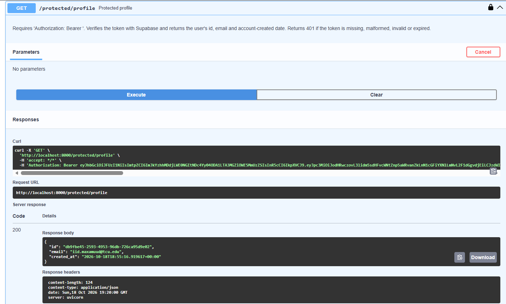

# Task API

A small FastAPI to-do API with user authentication. **Supabase Auth** is the Identity Provider: it stores the accounts, hashes the passwords and signs the JSON Web Tokens (JWTs). This API forwards sign-up/log-in requests to Supabase, then verifies the bearer token on every protected route before letting the request through. Tasks are stored in Postgres, and the whole stack runs with Docker Compose.

## How auth works

1. The client signs up or logs in through `POST /auth/signup` / `POST /auth/login`. The API forwards the email and password to Supabase and never stores them.
2. Login returns Supabase's `access_token` (a JWT, valid for one hour) and `refresh_token`.
3. The client calls a protected route with `Authorization: Bearer <access_token>`.
4. A reusable FastAPI dependency (`get_current_user` in `auth.py`) asks Supabase whether the token is real (`supabase.auth.get_user(token)`). If it is, the route runs with the user injected. If it's missing, malformed, tampered with or expired, the route answers `401`.

## Setup

**Prerequisites:** Docker Desktop and a free [Supabase](https://supabase.com) project.

1. In the Supabase dashboard, open **Project Settings → API** and copy the **Project URL** and the **anon** key. Never use the `service_role` key here; it bypasses all security.
2. For this practice project, open **Authentication → Sign In / Providers → Email** and turn **Confirm email** off so a new account can log in immediately.
3. Copy the example env file and fill in your values:

```powershell
Copy-Item .env.example .env
```

| Variable            | What it is                                                                        |
|---------------------|-----------------------------------------------------------------------------------|
| `POSTGRES_PASSWORD` | Password for the Postgres container                                               |
| `POSTGRES_DB`       | Database name (e.g. `tasks`)                                                      |
| `DATABASE_URL`      | Used only when running uvicorn outside Docker; Compose overrides it with the `db` host |
| `SUPABASE_URL`      | Your Supabase Project URL                                                         |
| `SUPABASE_KEY`      | Your Supabase **anon** key                                                        |

`.env` is git-ignored and listed in `.dockerignore`, so your keys never reach GitHub or the image.

## Run it (one command)

```powershell
docker compose up --build
```

The API is at `http://localhost:8000` and Swagger UI is at `http://localhost:8000/docs`. To reset the task database, run `docker compose down -v`.

## Auth endpoints

| Method | Path                  | Auth required | Body                    | Success                             | Errors                                     |
|--------|-----------------------|---------------|-------------------------|-------------------------------------|--------------------------------------------|
| POST   | `/auth/signup`        | No            | `{"email", "password"}` | 201 + Supabase user                 | 400 missing field / rejected by Supabase   |
| POST   | `/auth/login`         | No            | `{"email", "password"}` | 200 + `access_token`, `refresh_token` | 400 missing field, 401 wrong credentials |
| POST   | `/auth/logout`        | **Bearer**    | —                       | 204, no body                        | 401 missing / invalid / expired token      |
| GET    | `/protected/profile`  | **Bearer**    | —                       | 200 + `id`, `email`, `created_at`   | 401 missing / invalid / expired token      |
| GET    | `/protected/dashboard`| **Bearer**    | —                       | 200 + greeting                      | 401 missing / invalid / expired token      |
| GET    | `/public/info`        | No            | —                       | 200 + public message                | —                                          |

Every error is JSON in the form `{"error": "..."}`. A missing, malformed (not `Bearer <token>`) or empty token returns `Access token required`. A token Supabase rejects returns `Invalid or expired token`.

## Task endpoints (no auth)

| Method | Path          | Description                        | Success | Errors                                  |
|--------|---------------|------------------------------------|---------|-----------------------------------------|
| GET    | `/`           | API info                           | 200     | —                                       |
| GET    | `/health`     | Health check                       | 200     | —                                       |
| GET    | `/tasks`      | List all tasks                     | 200     | —                                       |
| GET    | `/tasks/{id}` | Get one task                       | 200     | 404 unknown id                          |
| POST   | `/tasks`      | Create a task (`{"title": "..."}`) | 201     | 400 missing/empty title                 |
| PUT    | `/tasks/{id}` | Update a task's title and/or done  | 200     | 404 unknown id, 400 empty body or title |
| DELETE | `/tasks/{id}` | Delete a task                      | 204     | 404 unknown id                          |

Values of the wrong type (e.g. `"done": "yes"`) are rejected by FastAPI with 422.

## Try the full flow with curl

In Windows PowerShell, use `curl.exe` (plain `curl` is an alias for `Invoke-WebRequest`). Use any email address you like.

```powershell
# 1. Sign up -> 201
curl.exe -i -X POST http://localhost:8000/auth/signup -H "Content-Type: application/json" -d '{\"email\":\"you@example.com\",\"password\":\"password123\"}'

# 2. Log in -> 200, copy the access_token from the response
curl.exe -i -X POST http://localhost:8000/auth/login -H "Content-Type: application/json" -d '{\"email\":\"you@example.com\",\"password\":\"password123\"}'

# 3. Protected route with the token -> 200
curl.exe -i http://localhost:8000/protected/profile -H "Authorization: Bearer <ACCESS_TOKEN>"

# 4. Change one character of the token -> 401 {"error":"Invalid or expired token"}
# 5. No token at all -> 401 {"error":"Access token required"}
curl.exe -i http://localhost:8000/protected/profile

# 6. Log out -> 204
curl.exe -i -X POST http://localhost:8000/auth/logout -H "Authorization: Bearer <ACCESS_TOKEN>"
```

## Swagger UI

Open `http://localhost:8000/docs`. The protected routes show a padlock. Click **Authorize**, paste the `access_token` from `POST /auth/login`, then use **Try it out** on `GET /protected/profile`.



## Project layout

| File                 | Role                                                                                       |
|----------------------|--------------------------------------------------------------------------------------------|
| `main.py`            | FastAPI app, request models and routes                                                     |
| `auth.py`            | The auth guard: `HTTPBearer` scheme, `get_bearer_token` and `get_current_user` dependencies |
| `repository.py`      | Postgres task queries and Supabase Auth calls (sign up, log in, verify token, log out)     |
| `supabase_client.py` | Creates the Supabase client from `SUPABASE_URL` / `SUPABASE_KEY`                           |
| `compose.yaml`       | `api` + `db` (Postgres 17) services                                                        |
